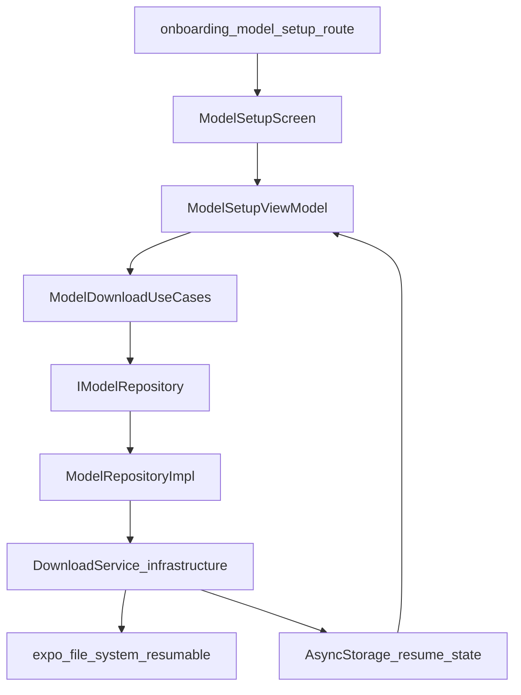

# 6-Card Models + Download Pipeline Plan

## Scope Locked

- Apply UI to [D:/Side Hustle/lokalmind-app/app/onboarding/model-setup.tsx](D:/Side Hustle/lokalmind-app/app/onboarding/model-setup.tsx) only.
- Implement background download behavior for:
  - app in background
  - app relaunched after terminate (restore status + continue/resume where possible)
- Exclude Dynamic Island/Live Activity in this phase.

## Architecture and File Targets

- Keep routes thin; move business logic to new models feature module.
- Update model registry in [D:/Side Hustle/lokalmind-app/src/infrastructure/downloads/modelConfig.ts](D:/Side Hustle/lokalmind-app/src/infrastructure/downloads/modelConfig.ts) to exactly 6 models using your provided metadata.
- Implement infra download engine in [D:/Side Hustle/lokalmind-app/src/infrastructure/downloads/downloadService.ts](D:/Side Hustle/lokalmind-app/src/infrastructure/downloads/downloadService.ts) with throttled progress and persistent state.
- Add models feature module (new):
  - `src/features/models/domain/entities/Model.ts`
  - `src/features/models/domain/repositories/IModelRepository.ts`
  - `src/features/models/domain/usecases/*.ts`
  - `src/features/models/data/repositories/ModelRepositoryImpl.ts`
  - `src/features/models/presentation/viewmodels/ModelSetupViewModel.ts`
  - `src/features/models/presentation/components/ModelCard.tsx`
  - `src/features/models/presentation/screens/model-setup-screen/ModelSetupScreen.tsx`
  - `src/features/models/presentation/screens/model-setup-screen/ModelSetupScreenStyles.ts`
- Wire DI in [D:/Side Hustle/lokalmind-app/src/core/di/container.ts](D:/Side Hustle/lokalmind-app/src/core/di/container.ts).

## UI Behavior (Onboarding Screen)

- New card layout (6 cards):
  - top row: model logo/icon + model name
  - middle: short description
  - bottom-left: size text
  - right-middle: SF Symbol download button
- On download tap:
  - card expands inline
  - shows progress bar, speed, ETA
  - shows pause + cancel actions
  - status survives app restarts via persisted download state

## Download Engine Design (Optimized)

- Use `expo-file-system` resumable downloads in infrastructure.
- Track active downloads in-memory + persist resumable metadata in AsyncStorage for restore-on-launch.
- Compute speed/ETA via rolling window samples (smoother than raw instantaneous values).
- Throttle progress events to 250ms before pushing to ViewModel.
- Support `start`, `pause`, `resume`, `cancel`, `getDownloadState` fully.
- On app start/screen mount:
  - hydrate persisted states
  - reconcile partial files
  - auto-resume or mark paused/failed with explicit reason

## Background + Terminate Strategy (Phase A+B)

- Backgrounded app: rely on resumable download/session behavior and persisted state updates.
- After terminate/relaunch: restore from persisted resumable metadata and continue/resume download if valid.
- Add task registration scaffolding for background processing continuation checks using existing `expo-background-task` dependency.
- Keep implementation graceful on Android (best effort); primary guarantee target is iOS behavior.

## Required Apple/Expo Config Changes

- Update [D:/Side Hustle/lokalmind-app/app.config.ts](D:/Side Hustle/lokalmind-app/app.config.ts):
  - add iOS background modes needed for long processing/download workflows
  - add task identifiers used by background task scheduler
- You will likely need to enable corresponding Apple capabilities in your App ID/profile (Background Modes).
- Dynamic Island/Live Activity is not included now; that would require ActivityKit integration and separate native setup.
- Reference you shared: [Background GPU Access (Apple)](https://developer.apple.com/documentation/BundleResources/Entitlements/com.apple.developer.background-tasks.continued-processing.gpu)

## Branch + Validation

- Create/switch to a dedicated feature branch before edits.
- Validate with lint + typecheck for touched files and run onboarding flow manually:
  - render 6 cards
  - start/pause/resume/cancel
  - background app then return
  - terminate app then relaunch and verify restored state.

## Data Flow

