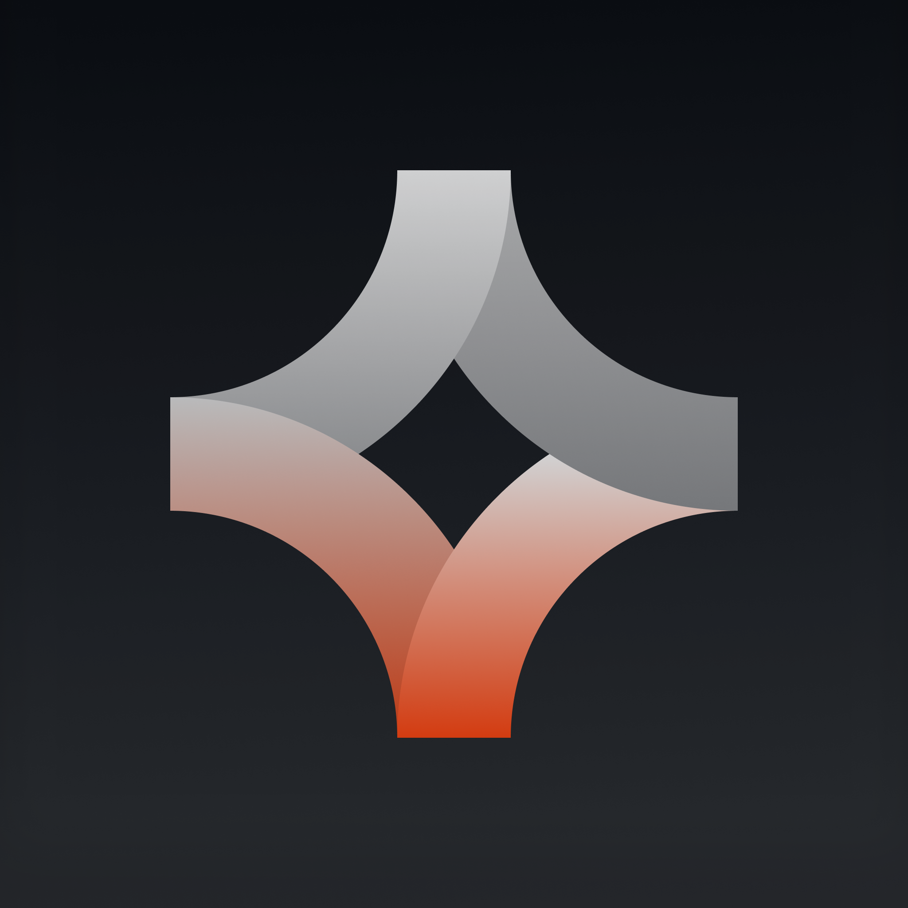
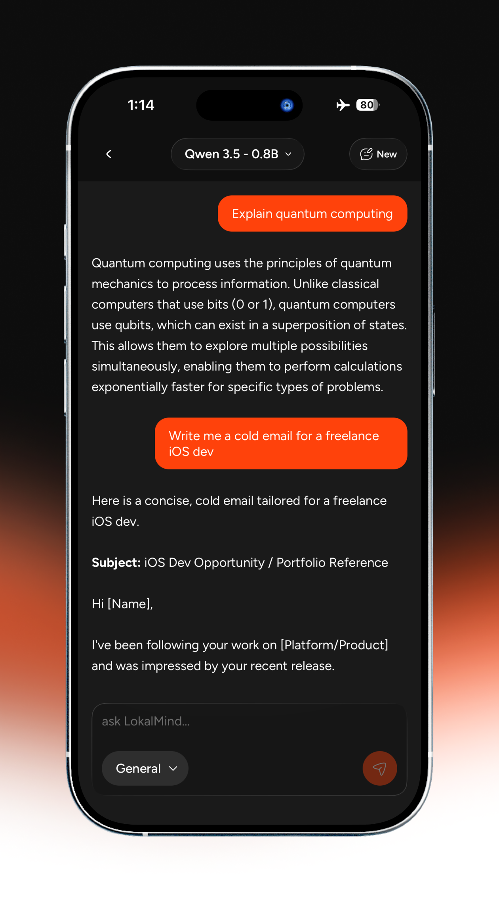
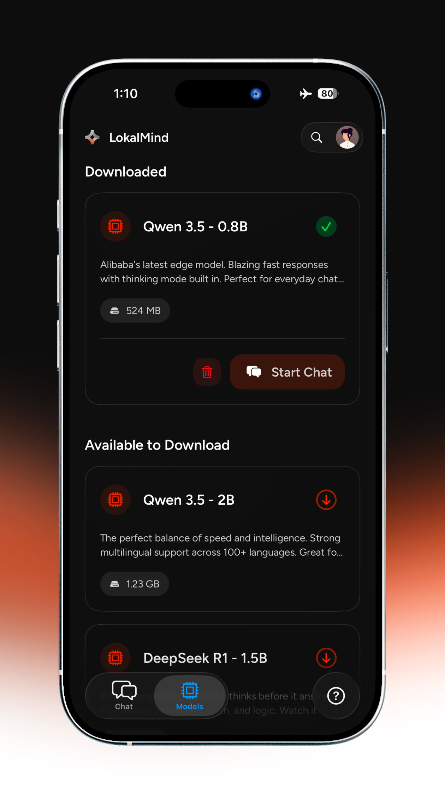
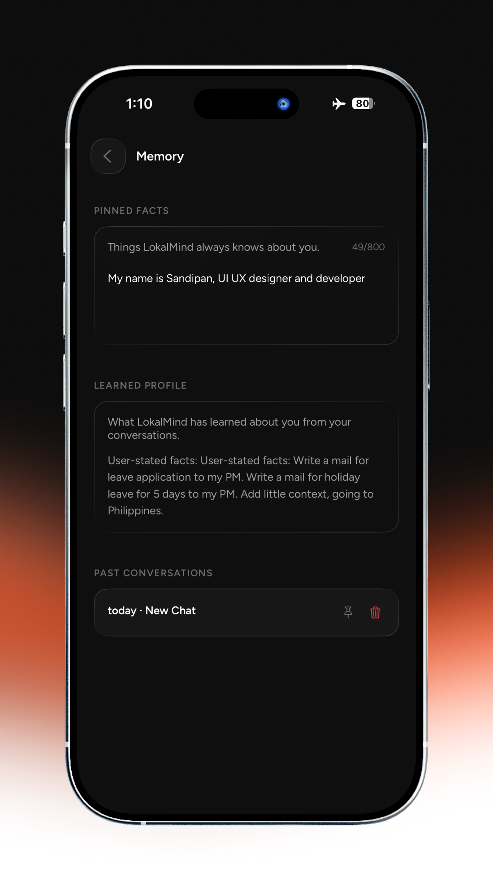
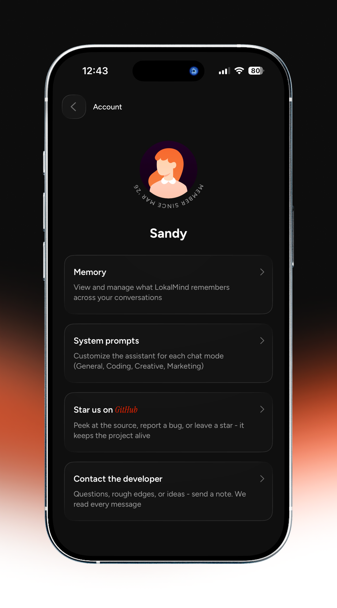

<div align="center">



# LokalMind

**Private AI chat that runs entirely on your phone.**  
No cloud. No subscriptions for core chat. Your data never leaves your device.

[](LICENSE)
[](#)
[](https://expo.dev)
[](https://reactnative.dev)
[](CONTRIBUTING.md)

<br />

<!-- Hero screenshot — replace with your actual App Store screenshot -->


<br /><br />

[**Download on the App Store**](https://apps.apple.com/in/app/lokalmind-offline-ai/id6753812012) &nbsp;·&nbsp; [Report a Bug](https://github.com/Sandipan006/lokalmind-app/issues) &nbsp;·&nbsp; [Request a Feature](https://github.com/Sandipan006/lokalmind-app/issues) &nbsp;·&nbsp; [Discussions](https://github.com/Sandipan006/lokalmind-app/discussions)

</div>

---

## Why LokalMind?

Most AI assistants send everything you type to a server. LokalMind doesn't. The model runs on your phone, responses generate on your CPU/GPU, and nothing is transmitted anywhere.

- **Truly private** — no account, no telemetry, no API calls
- **Works offline** — on a plane, in a basement, anywhere
- **One-time download** — download a model once, use it forever
- **Remembers you** — on-device semantic memory across conversations
- **Fast** — Metal-accelerated inference on Apple Silicon

---

## Screenshots

<!-- Add your actual screenshots here. Recommended: 4–5 key screens -->
<!-- Tip: Use App Store screenshot dimensions (1290×2796 for iPhone 16 Pro Max) -->

<div align="center">
<table>
  <tr>
    <td align="center">
      
      <br /><sub><b>Chat</b></sub>
    </td>
    <td align="center">
      
      <br /><sub><b>Models</b></sub>
    </td>
    <td align="center">
      
      <br /><sub><b>Memory</b></sub>
    </td>
    <td align="center">
      
      <br /><sub><b>Settings</b></sub>
    </td>
  </tr>
</table>
</div>

---

## Features

| | Feature | Description |
|---|---------|-------------|
| 💬 | **Streaming chat** | Tokens stream live with haptic feedback |
| 🎙️ | **Voice input** | Whisper-powered on-device STT |
| 🧠 | **Cross-session memory** | Remembers facts using local semantic search (all-MiniLM-L6-v2) |
| 🔁 | **Reply to message** | Thread-style replies inside any conversation |
| 🎭 | **Chat modes** | General · Code · Reasoning · Creative · and more |
| 📥 | **Resumable downloads** | Large GGUF models download in the background, resume on reconnect |
| 🔧 | **Custom system prompts** | Global and per-session system prompts |
| 🌗 | **Dark-first UI** | Apple Liquid Glass design, `#FF420B` accent on `#0F0F0F` |

---

## Models

| Model | Size | RAM | Best for |
|-------|------|-----|----------|
| Qwen 3.5 · 0.8B | 550 MB | 2 GB+ | Fast everyday chat |
| Qwen 3.5 · 2B | 1.3 GB | 3 GB+ | Summaries, multilingual |
| DeepSeek R1 · 1.5B | 1.1 GB | 3 GB+ | Coding, math, reasoning |
| Qwen 3.5 · 4B | 2.9 GB | 4 GB+ | Complex tasks, creative |
| Qwen 3 · 4B | 2.5 GB | 4 GB+ | Thinking mode, coding |
| Gemma 3 · 4B | 2.5 GB | 4 GB+ | Long context, analysis |

> **Tip:** Start with Qwen 0.8B for speed. Upgrade to a 4B model when you need deeper reasoning.

---

## Tech Stack

| Layer | Technology |
|-------|-----------|
| Runtime | Expo ~54 · React Native 0.81 · React 19 |
| Navigation | Expo Router ~6 |
| State | MobX 6 · mobx-react-lite |
| Inference | llama.rn (GGUF) |
| Voice | whisper.rn (base, 142 MB) |
| Storage | expo-sqlite · AsyncStorage |
| Payments | RevenueCat |
| Architecture | Clean Architecture · `Result<T>` flows · DI container |

---

## Quick Start

```bash
git clone https://github.com/Sandipan006/lokalmind-app.git
cd lokalmind-app
npm install
cp .env.example .env
npx expo run:ios
```

> **Note:** Expo Go is **not supported** — native modules (`llama.rn`, `whisper.rn`) require a custom dev build.

The `.env.example` ships with all public defaults pre-filled. Model downloads work out of the box — no credentials needed.

---

## Environment

`app.config.ts` injects env vars at build time via Expo `extra`. Runtime reads them from `src/config/env.ts`.

```bash
cp .env.example .env
# Required:
#   IOS_BUNDLE_IDENTIFIER   - your bundle ID (e.g. com.yourname.lokalmind)
#
# Only needed for EAS cloud builds:
#   EAS_PROJECT_ID
#   APP_OWNER
```

Everything else (CDN URL, LLM defaults, download settings) works without changes.

---

## Repository Layout

```
app/                    Expo Router routes (thin — no business logic)
src/
  core/                 DI container, ports (interfaces), shared Result<T> type
  features/
    chat/               └── domain / data / presentation
    memory/             └── cross-session memory & embeddings
    models/             └── download, manage GGUF models
    onboarding/         └── first-run flow
    profile/            └── settings, pinned facts, storage
  infrastructure/       Adapters — llama.rn, whisper.rn, SQLite, downloads
  design-system/        Tokens (colors, typography, spacing, glass)
  config/               env.ts — runtime config
```

---

## Architecture

```
Presentation  →  Use Cases  →  Domain entities
                    ↕
              Repository interfaces
                    ↕
           Data layer (implements repos)
                    ↕
         Infrastructure (llama.rn, SQLite…)
```

- **Domain** — pure TypeScript, zero third-party imports
- **Presentation** — screens + MobX ViewModels, calls use cases only
- **Data** — implements repository interfaces, receives infra via constructor injection
- **Infrastructure** — the only layer that imports `llama.rn`, `whisper.rn`, `expo-sqlite`
- **Composition root** — `src/core/di/container.ts`

---

## Scripts

| Command | Purpose |
|---------|---------|
| `npm run start` | Expo dev server |
| `npm run ios` | Run on device / simulator |
| `npm run lint` | ESLint |
| `npm run reset-project` | Reset local state |

---

## Roadmap

- [ ] **v1.1** — Tool use (Reminders & Calendar via EventKit)
- [ ] **v1.2** — On-device TTS
- [ ] **v1.3** — Android support
- [ ] More models (Mistral, Phi-4)
- [ ] iCloud sync for conversations (opt-in)

Have an idea? [Open a discussion →](https://github.com/Sandipan006/lokalmind-app/discussions/categories/ideas)

---

## Contributing

Contributions are welcome! See [CONTRIBUTING.md](CONTRIBUTING.md) for setup instructions, branch conventions, and code style.

Found a security issue? See [SECURITY.md](SECURITY.md) — please don't open a public issue.

---

## Built by

**Sandipan Bera** — React Native developer & UI/UX designer from Kolkata, India.

LokalMind is built in public. If it's useful to you, a ⭐ goes a long way.

Follow the journey → **[@hey_sandipan](https://x.com/hey_sandipan)**

**Support the project:**

[](https://paypal.me/sandipan804)
[](https://checkout.dodopayments.com/buy/pdt_IEOG0s908rxVulWQVLxkV?quantity=1)

---

## License

[MIT](LICENSE) © 2026 Sandipan Bera